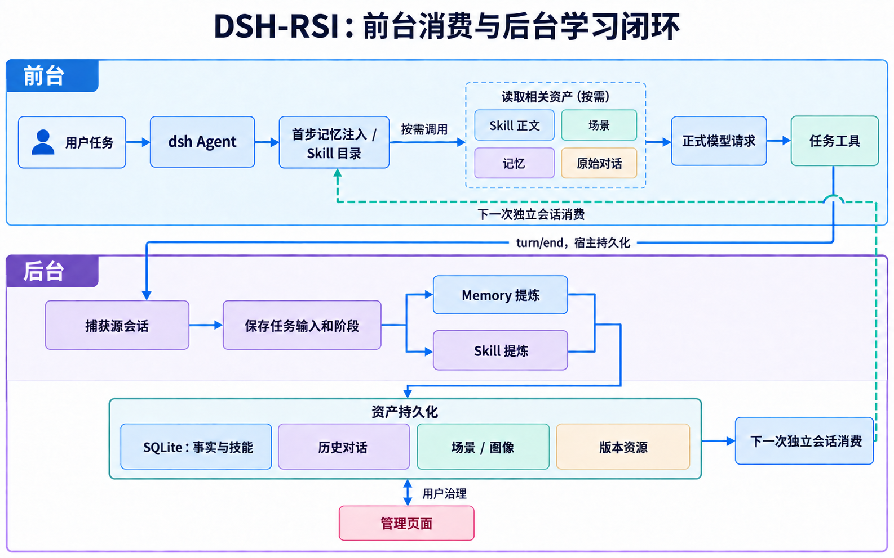
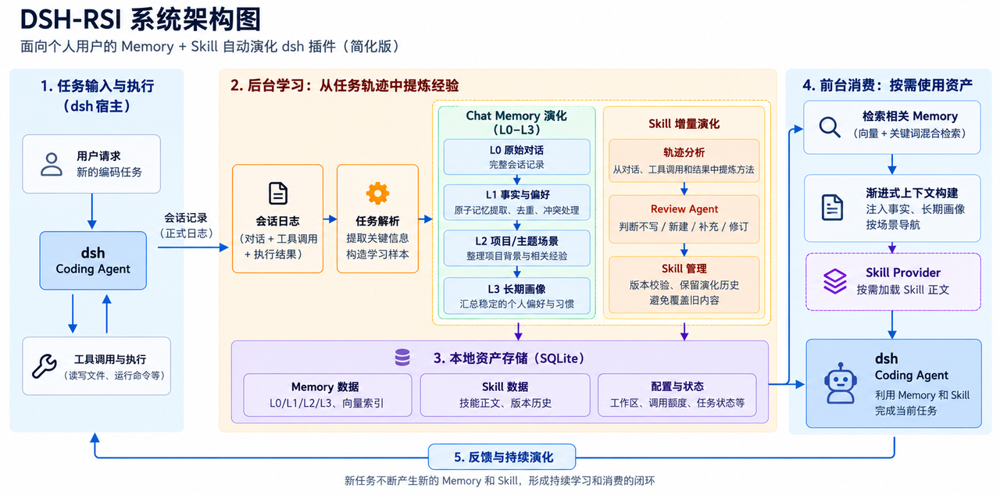
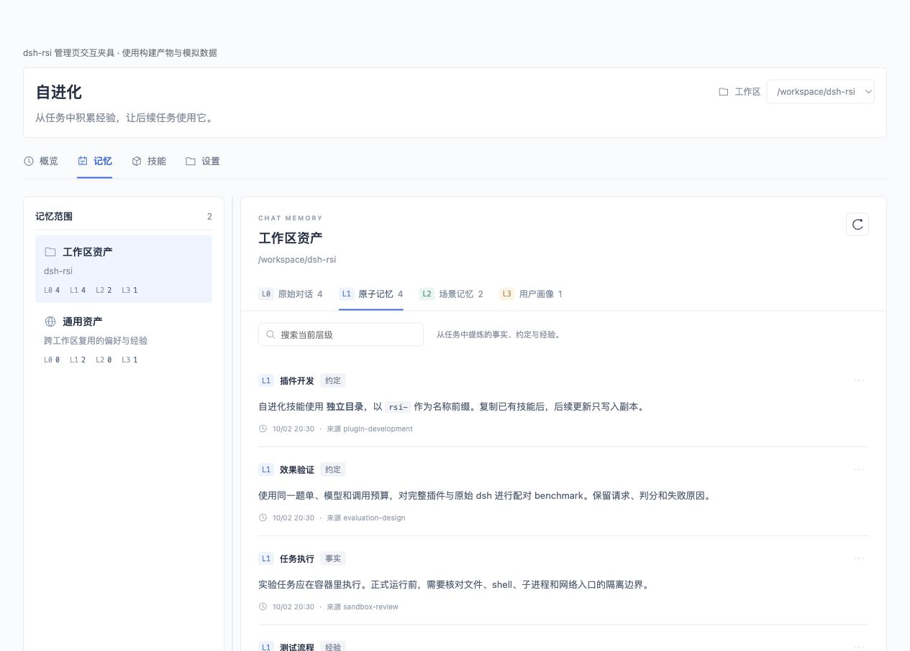
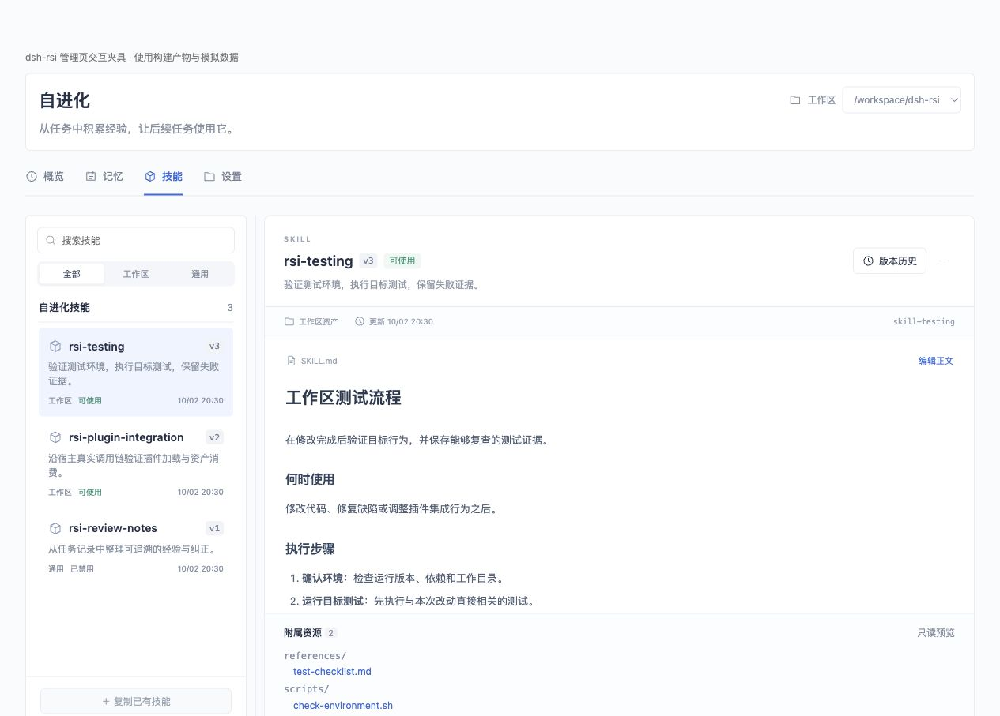

# dsh-rsi

**让 Coding Agent 从历史任务中积累可复用的 Memory 与 Skill，并在后续会话中按需使用。**

`dsh-rsi` 是面向 DeepSeek Harness（dsh） 的单用户、本地自动学习插件。它在不改变 dsh 核心 Agent 执行循环的前提下，采集真实会话与工具执行轨迹，异步提炼两类长期资产：

- **Chat Memory**：保存事实、用户偏好、项目约定和长期场景，支持更新、冲突处理与检索。
- **Skill**：从任务执行经验中提炼可复用的方法，支持创建、增量修订、版本管理和按需加载。

目标不是让模型自行修改权重或插件源码，而是实现**外部记忆和技能资产的持续演化**。

> **项目状态：开发中。** 会话采集、资产提炼、持久化、管理界面以及后续独立会话中的真实资产消费已完成相关验证；当前实验尚未证明稳定的任务效果提升。详见[验证状态](#验证状态)。

## 核心能力

| 能力 | 实现方式 |
| --- | --- |
| 真实轨迹采集 | 通过 dsh 会话事件读取用户/助手消息、工具调用及结果，过滤插件自身会话和重复历史 |
| 分层 Chat Memory | L0 原始对话 → L1 原子记忆 → L2 项目/主题场景 → L3 长期画像；L1 支持去重、修正和合并 |
| Skill 增量演化 | Review Agent 结合当前任务轨迹与已有 Skill，决定跳过、新建、局部修改或整体更新 |
| 渐进式资产消费 | Memory 混合检索并按预算注入；Skill 经官方 Provider 暴露，正文和资源按需加载 |
| 本地治理与恢复 | 工作区/Global 隔离、持久化学习任务、阶段恢复、Skill 版本及回滚、后台调用额度 |
| 集成管理界面 | 在 dsh 插件详情页查看 Memory、Skill、来源、版本、学习状态和成本 |

## 工作原理



### 1. 采集：保留真实任务证据

插件监听 dsh 的 `session/event`，在任务轮次结束后读取已持久化的会话事件。Memory 主要使用用户与助手正文；Skill Review 额外使用工具调用、执行结果及结束原因。后台学习任务写入 SQLite，并通过来源游标与唯一任务 ID 防止重复入队。

### 2. 学习：Memory 与 Skill 分别演化

**Memory：** L1 从对话中提炼原子记忆，使用已有记忆检索与 LLM 判断执行 `Store / Skip / Update / Merge`；L2 异步整理相关场景，L3 在满足触发条件时更新长期画像。底层 L1 被纠正后，旧的派生场景与画像会暂时失效，等待重建。

**Skill：** Review Agent 读取任务轨迹与已有 Skill，调用资产工具创建或修订 `SKILL.md`，并将较长的脚本、模板等保存为资源文件。写入时执行版本校验，历史版本保留，可人工编辑、禁用或回滚。

两条学习路径共享会话采集和后台调度，但 Skill 不必等待 L2/L3 生成完成。

### 3. 消费：下一次任务按需使用资产

- **Memory**：在 `agent/pre-step` 的首个模型步骤前，使用 SQLite FTS5、向量检索与 RRF 召回相关 L1，并在默认 **6000 字符**预算内提供相关记忆、场景导航和画像。模型还可通过 `rsi_memory_search`、`rsi_conversation_search`、`rsi_profile_read` 查询详情。
- **Skill**：通过 dsh 官方 Skill Provider 暴露带 `rsi-` 前缀的技能名称与描述，Agent 自行决定是否加载正文及对应版本的资源。

**资产生成、资产进入模型上下文和任务效果改善是三个不同的验证环节。** 历史 Skill 中记载的测试结果，也不能作为当前会话已经执行测试的证据。

## 系统架构



项目主要由四部分组成：

| 模块 | 主要职责 |
| --- | --- |
| dsh 宿主接入 | 会话事件、模型步骤、Skill Provider、插件管理 API |
| 后台执行与治理 | 模型桥接、学习队列、预算、诊断日志和作用范围 |
| Memory / Skill 核心 | 分层提炼、检索、Review Agent、资源与版本处理 |
| 管理页面与 UI 适配 | 资产浏览、编辑、版本管理、学习状态和设置 |


## 快速开始

### 环境要求

- 官方 dsh；当前兼容目标为 `0.2.0-rc.2`（Cordis `4.0.4`）。
- Node.js **24 或更高版本**。
- 在 dsh 中配置可用的模型；后台学习默认跟随来源会话的模型。

### 1. 构建插件

```bash
git clone https://github.com/lsmax-72/dsh-rsi.git
cd dsh-rsi
npm ci
```

`npm ci` 会通过 `prepare` 自动运行构建；如果安装时禁用了生命周期脚本，需要手动执行 `npm run build`。

### 2. 安装到 dsh

在项目目录执行 `pwd`（Windows 可获取对应的绝对目录路径）。打开 dsh 的 **插件 → 添加插件**，选择或输入构建后的项目目录，安装并启用。随后进入插件详情页。

目前已验证**本地目录安装**；尚未完成通过远程 GitHub URL 安装的端到端验收。项目当前为 `private: true`，未发布到 npm。

### 3. 开始使用

1. 在 dsh 中打开一个项目工作区，正常执行 Coding Agent 任务。
2. 在插件「概览」中查看后台学习任务、资产数量与模型调用记录。
3. 在「记忆」「技能」页检查和修正生成的资产。
4. 后续在相同工作区的新会话中继续任务，检查 Memory 召回与 Skill 是否被自然加载。

首次使用时资产为空是正常现象；任务结束也不保证一定生成新 Memory 或 Skill。

## 资产管理

管理入口：**dsh 左侧「插件」→ dsh-rsi → 插件详情**。

| 页面 | 功能 |
| --- | --- |
| 概览 | 工作区选择、任务状态、资产数量与学习成本 |
| 记忆 | 查看 L0–L3、来源追溯、L1 纠正或删除 |
| 技能 | 查看正文和资源、编辑、禁用、历史版本及回滚、复制为 Global Skill |
| 设置 | 学习开关、语言与调用预算、资产导出和清理 |





> 以上管理页面截图使用模拟数据，不代表真实学习成果或实验效果。当前 L2/L3 不支持直接编辑，Skill 资源提供只读预览。

### 工作区和 Global

项目资产按 dsh 会话绑定的工作区真实路径隔离；个人偏好等通用记忆可以进入 Global，Skill 可以手动复制为 Global 版本。后续任务只消费**当前工作区和 Global** 资产，不会自动访问其他工作区的专属内容。范围分类与冲突判断涉及 LLM，仍可能出现错误。

默认数据目录为 `$DSH_HOME/plugin-data/dsh-rsi`；未配置 `DSH_HOME` 时使用 `~/.dsh/plugin-data/dsh-rsi`。其中 `rsi-state.sqlite` 保存队列、设置与调用记录，各 Scope 分别保存 `memory.sqlite`、`skills.sqlite`、Skill 资源及画像文件。完整布局参见[实现进度](docs/implementation-progress.md)。

## 默认配置

| 配置项 | 默认值 |
| --- | --- |
| 自动学习触发 | 稳定阶段每 2 轮或空闲 30 秒；保留首次 Warmup |
| 每日后台模型请求预算 | 100 次 |
| 单次模型输出上限 | 4096 Token |
| 单次后台模型运行循环上限 | 16 步 |
| 单次后台模型运行超时 | 180 秒 |
| 自动 Memory 注入预算 | 6000 字符 |

请求预算按 UTC 日期计算，包含工具循环和失败的模型请求；**它不是费用或 Token 总量上限**。后台学习会增加模型调用成本，即使学习暂停，已保存的资产仍可消费。

## 验证状态

当前验证主要分为两个层面：

- **链路可用性**：已验证会话捕获、后台提炼与持久化、管理界面、独立会话中的真实 Memory/Skill 正文消费，以及相关构建与恢复检查。
- **任务效果**：已有开发样本尚未证明插件能够稳定提升任务成功率；已有实验存在效果不增反降、Token 开销明显增长的情况。开发样本已曝光，不能作为独立盲测结果。新的正式扩大实验尚待完成。

完整历史结果及问题分析保留在 [PersonaMem 开发复验](docs/personamem-native-v2-outcome-20261007.md)、[连续学习实验](docs/continuous-learning-outcome-20261005.md) 和 [实验推进记录](docs/rsi-roadmap-20261004.md)。README 不以生成的资产数量替代效果证据。

## 开发与文档

```bash
npm run build
npm run test:integration
npm run test:runtime
npm run test:package
```

上述集成检查中的固定响应部分不调用真实模型，不能替代真实任务质量评测。提交代码前请阅读 [AGENTS.md](AGENTS.md)。

进一步阅读：[产品需求](docs/product-requirements.md) · [实现进度](docs/implementation-progress.md) · [dsh 接入审查](docs/integration-audit.md) · [安装与发布审查](docs/packaging-review.md) · [管理页验收](docs/client-mount-review.md)

本项目不包含模型权重训练、自动修改插件自身源码、团队权限系统或自动索引整个代码库。历史记录、详细故障分析与实验协议保存在 `docs/`。

## 开源参考与致谢

本项目的设计与实现参考了以下开源项目：

- [TencentDB-Agent-Memory](https://github.com/TencentCloud/TencentDB-Agent-Memory)
