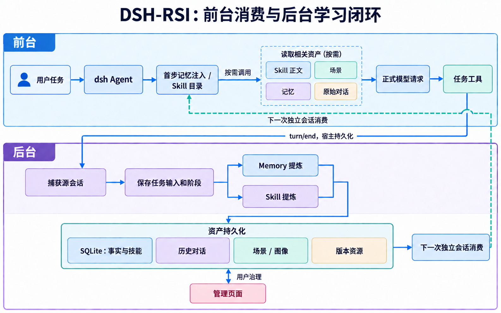
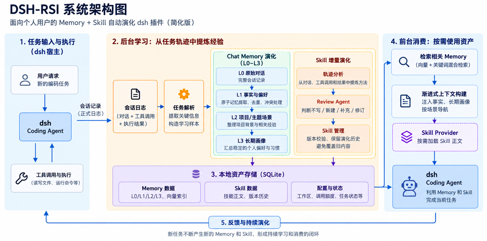
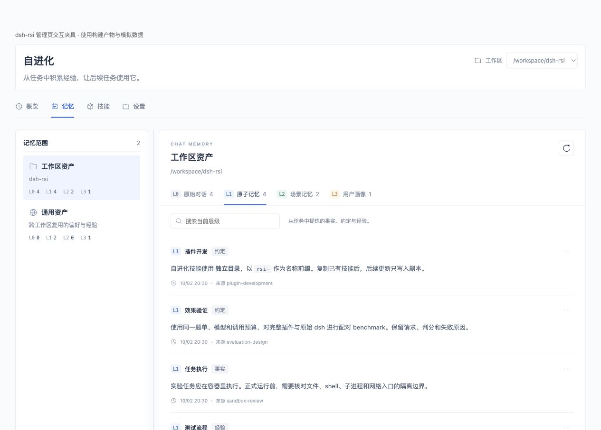
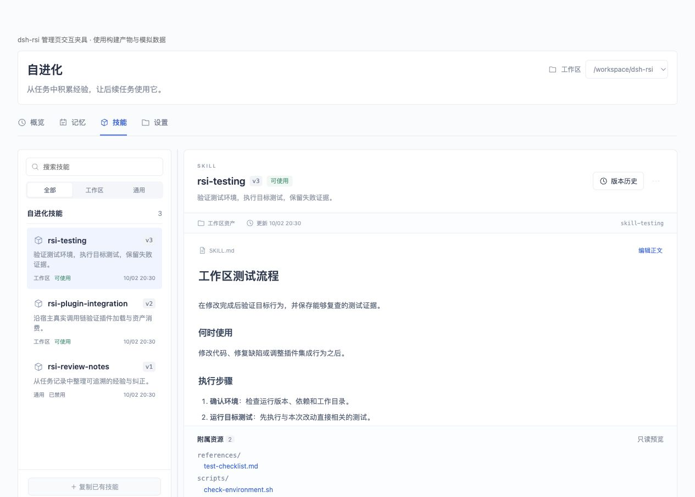

# dsh-rsi

**让 Coding Agent 从历史任务中积累可复用的 Memory 与 Skill，并在后续会话中按需使用。**

`dsh-rsi` 是面向 DeepSeek Harness（dsh） 的单用户、本地自动学习插件。它在不改变 dsh 核心 Agent 执行循环的前提下，采集真实会话与工具执行轨迹，异步提炼两类长期资产：

- **Chat Memory**：保存事实、用户偏好、项目约定和长期场景，支持更新、冲突处理与检索。
- **Skill**：从任务执行经验中提炼可复用的方法，支持创建、增量修订、版本管理和按需加载。

目标不是让模型自行修改权重或插件源码，而是实现**外部记忆和技能资产的持续演化**。

> **项目状态：开发中。**

## 核心能力

| 能力 | 实现方式 |
| --- | --- |
| 真实轨迹采集 | 通过 dsh 会话事件读取用户/助手消息、工具调用及结果，过滤插件自身会话和重复历史 |
| 分层 Chat Memory | L0 原始对话 → L1 原子记忆 → L2 项目/主题场景 → L3 长期画像；L1 支持去重、修正和合并 |
| Skill 增量演化 | Review Agent 结合当前任务轨迹与已有 Skill，决定跳过、新建、局部修改或整体更新 |
| 渐进式资产消费 | Memory 混合检索并按预算注入；Skill 经官方 Provider 暴露，正文和资源按需加载 |
| 本地治理与恢复 | 工作区/Global 隔离、持久化学习任务、阶段恢复、Skill 版本及回滚、后台调用额度 |
| 集成管理界面 | 在 dsh 插件详情页查看 Memory、Skill、来源、版本、学习状态和成本 |

## 工作原理



### 1. 采集：保留真实任务证据

插件监听 dsh 的 `session/event`，在任务轮次结束后读取已持久化的会话事件。Memory 主要使用用户与助手正文；Skill Review 额外使用工具调用、执行结果及结束原因。后台学习任务写入 SQLite，并通过来源游标与唯一任务 ID 防止重复入队。

每次后台提炼都是一次真实的 dsh 会话，因此请求日志可以逐条重建（学习记录见 `learning-runs/`）。这些会话不是用户发起的对话：插件在提炼结束后调用宿主 `WorkspaceRegistry.archiveSession` 把它们从会话列表的归组视图中隐藏，启动时也会把更早版本留下的同类会话一并隐藏。日志、历史与来源记录都保留，可在会话列表中恢复。

### 2. 学习：Memory 与 Skill 分别演化

**Memory：** L1 从对话中提炼原子记忆，使用已有记忆检索与 LLM 判断执行 `Store / Skip / Update / Merge`；L2 异步整理相关场景，L3 在满足触发条件时更新长期画像。底层 L1 被纠正后，旧的派生场景与画像会暂时失效，等待重建。

**Skill：** Review Agent 读取任务轨迹与已有 Skill，调用资产工具创建或修订 `SKILL.md`，并将较长的脚本、模板等保存为资源文件。写入时执行版本校验，历史版本保留，可人工编辑、禁用或回滚。

两条学习路径共享会话采集和后台调度，但 Skill 不必等待 L2/L3 生成完成。

### 3. 消费：下一次任务按需使用资产

- **Memory**：在 `agent/pre-step` 的首个模型步骤前，使用 SQLite FTS5、向量检索与 RRF 召回相关 L1，并在默认 **6000 字符**预算内提供相关记忆、场景导航和画像。模型还可通过 `rsi_memory_search`、`rsi_conversation_search`、`rsi_profile_read` 查询详情。
- **Skill**：通过 dsh 官方 Skill Provider 暴露带 `rsi-` 前缀的技能名称与描述，Agent 自行决定是否加载正文及对应版本的资源。

## 系统架构



项目主要由四部分组成：

| 模块 | 主要职责 |
| --- | --- |
| dsh 宿主接入 | 会话事件、模型步骤、Skill Provider、插件管理 API |
| 后台执行与治理 | 模型桥接、学习队列、预算、诊断日志和作用范围 |
| Memory / Skill 核心 | 分层提炼、检索、Review Agent、资源与版本处理 |
| 管理页面与 UI 适配 | 资产浏览、编辑、版本管理、学习状态和设置 |

## 快速开始

### 环境要求

- 官方 dsh；兼容范围为 `0.2.0-rc.2` 或 `>=0.2.1-rc.2 <0.3.0-0`（覆盖 0.2.1 与 0.2.2 系列）。已在 `0.2.2-rc.3` 上验证插件激活、记忆检索与 Skill Provider 加载；宿主兼容版本由 `package.json` 的 `engines.dsh` 声明。
- Node.js **24 或更高版本**。
- 在 dsh 中配置可用的模型；后台学习默认跟随来源会话的模型。

### 1. 构建插件

```bash
git clone https://github.com/lsmax-72/dsh-rsi.git
cd dsh-rsi
npm ci
```

`npm ci` 会通过 `prepare` 自动运行构建；如果安装时禁用了生命周期脚本，需要手动执行 `npm run build`。

### 2. 安装到 dsh

在项目目录执行 `pwd`（Windows 可获取对应的绝对目录路径）。打开 dsh 的 **插件 → 添加插件**，选择或输入构建后的项目目录，安装并启用。随后进入插件详情页。

项目当前为 `private: true`，未发布到 npm。

### 已安装插件的本地更新

如果通过本地目录链接安装，在插件项目目录中执行：

```bash
git pull
npm run build
```

完全退出并重新打开 dsh，在「插件 → dsh-rsi」中启用，确认版本为 `0.0.3`。如果仍显示旧版本或旧的兼容错误，使用插件管理页卸载旧条目，再通过「添加插件」重新添加上面的项目目录。不要删除插件数据目录，也不要在设置中执行「清理资产」。

更换电脑或首次下载时，先按上面的步骤执行 `npm ci`。插件目录需要保留，不能在安装后删除或移动。

### DSH 版本兼容

插件兼容范围由 `package.json` 的 `engines.dsh` 声明，当前为 `0.2.0-rc.2` 或 `>=0.2.1-rc.2 <0.3.0-0`。`0.2.2-rc.3` 已完成激活、记忆检索工具、召回注入与 Skill Provider 的实机验证；管理页界面的视觉验证和其余 0.2.2 版本仍以实际运行结果为准。RC 版本可能改变接口，范围声明不等于对所有未来版本的运行保证。

### 3. 开始使用

1. 在 dsh 中打开一个项目工作区，正常执行 Coding Agent 任务。
2. 在插件「概览」中查看后台学习任务、资产数量与模型调用记录。
3. 在「记忆」「技能」页检查和修正生成的资产。
4. 后续在相同工作区的新会话中继续任务，检查 Memory 召回与 Skill 是否被自然加载。

首次使用时资产为空是正常现象；任务结束也不保证一定生成新 Memory 或 Skill。

## 资产管理

管理入口：**dsh 左侧「插件」→ dsh-rsi → 插件详情**。

| 页面 | 功能 |
| --- | --- |
| 概览 | 工作区选择、任务状态、资产数量与学习成本 |
| 记忆 | 查看 L0–L3、来源追溯、L1 纠正或删除 |
| 技能 | 查看正文和资源、编辑、禁用、历史版本及回滚、复制为 Global Skill |
| 设置 | 学习开关、语言与调用预算、资产导出和清理 |





> 以上管理页面截图使用模拟数据。当前 L2/L3 不支持直接编辑，Skill 资源提供只读预览。

### 工作区和 Global

项目资产按 dsh 会话绑定的工作区真实路径隔离；个人偏好等通用记忆可以进入 Global，Skill 可以手动复制为 Global 版本。后续任务只消费**当前工作区和 Global** 资产，不会自动访问其他工作区的专属内容。范围分类与冲突判断涉及 LLM，仍可能出现错误。

默认数据目录为 `$DSH_HOME/plugin-data/dsh-rsi`；未配置 `DSH_HOME` 时使用 `~/.dsh/plugin-data/dsh-rsi`。其中 `rsi-state.sqlite` 保存队列、设置与调用记录，各 Scope 分别保存 `memory.sqlite`、`skills.sqlite`、Skill 资源及画像文件。

## 默认配置

| 配置项 | 默认值 |
| --- | --- |
| 自动学习触发 | 稳定阶段每 2 轮或空闲 30 秒；保留首次 Warmup |
| 每日后台模型请求预算 | 100 次 |
| 单次模型输出上限 | 4096 Token |
| 单次后台模型运行循环上限 | 16 步 |
| 单次后台模型运行超时 | 180 秒 |
| 自动 Memory 注入预算 | 6000 字符 |

请求预算按 UTC 日期计算，包含工具循环和失败的模型请求；**它不是费用或 Token 总量上限**。后台学习会增加模型调用成本，即使学习暂停，已保存的资产仍可消费。

### 嵌入模型

记忆检索使用本地 `embeddinggemma-300m`（768 维）。默认从 Hugging Face 下载到 `$DSH_HOME/plugin-data/dsh-rsi/models`；无法访问 Hugging Face 时，在 profile 的 `cordis.patch.yml` 中为 `dsh-rsi` 指定已有 GGUF 文件：

```yaml
- id: dsh-rsi
  config:
    embedding:
      provider: local
      modelPath: /path/to/embeddinggemma-300m-qat-Q8_0.gguf
```

向量模型未就绪时，记忆检索会明确报错，不会静默退回关键词检索。改动后需要重启 dsh 或重新启用插件才会生效。

## 源码目录

```text
src/
├── index.ts        # DSH 插件入口
├── runtime/        # 会话采集、调度、状态与预算
├── core/           # 复用核心导出与本地装配
├── model/          # DSH 模型调用桥接
├── memory/         # 检索上下文、向量与画像适配
├── skills/         # 技能资源、名称与正文预算
├── api/            # 资产查询与管理接口契约
└── client/         # 插件管理页面
adapters/           # 按宿主、观测、技能与客户端分组的适配
vendor/             # 固定修订的复用组件与第三方许可证
build/              # 构建入口和复用源码完整性校验
```

## 构建与许可

`src/` 按 `runtime`（调度与状态）、`core`（核心装配）、`model`（模型桥接）、`memory`（记忆与向量）、`skills`（技能资源）、`api`（管理接口）和 `client`（管理页面）组织。`adapters/` 按宿主、观测、技能和客户端划分适配代码，`vendor/` 保存固定修订的复用组件；`build/build.mjs` 负责构建，`verify-core.mjs` 与 `verify-panel.mjs` 在构建时校验复用源码的完整性。运行 `npm run build` 可重新生成 `lib/`。

运行时的 `@deepseek-ai/dsh-llm`、`@deepseek-ai/dsh-tools` 和 `@deepseek-ai/dsh-typert-protocol` 由 `src/host-packages.ts` 从当前 dsh 安装解析，与宿主共用同一模块实例；`peerDependencies` 仅作兼容声明并标记为可选，不随插件安装自己的副本。

记忆与技能核心及管理页面部分组件来自固定修订的复用组件，必要适配位于 `adapters/`。来源文件及修订见 `vendor/source-manifest.json`，第三方版权与许可证保留在 `vendor/LICENSE`。
